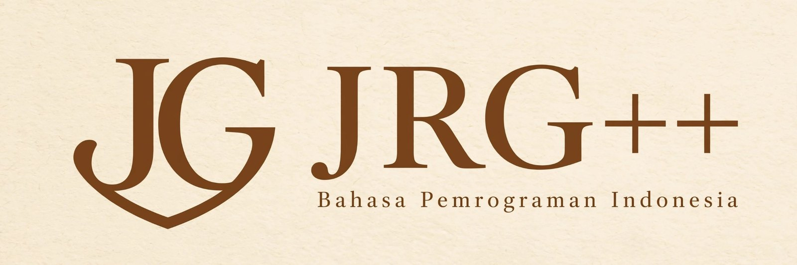

<p align="center">
  
</p>

<p align="center">
  Bahasa pemrograman dengan pesan galat berbahasa Indonesia.<br>
  <a href="https://jawarustgoplusplus.web.id/web_dokumentasi/index.html">Dokumentasi</a> ·
  <a href="https://jawarustgoplusplus.web.id/matematika_x_jrg/index.html">Matematika × JRG</a> ·
  <a href="https://jawarustgoplusplus.web.id/web_dokumentasi/pasang.html">Pasang</a> ·
  <a href="CHANGELOG.md">Perubahan</a>
</p>

---

**JawaRustGo++** (JRG) adalah bahasa pemrograman yang ditulis dengan Rust. Bentuk kodenya mirip Rust dan Go, diketik
dinamis, dan berkasnya berakhiran `.jrg`. Satu program bisa dijalankan lewat interpreter, mesin virtual bytecode, atau
dikompilasi jadi program native lewat LLVM, dan ketiganya memberi hasil yang sama.

```jrg
struct Murid { pub nama: string, pub nilai: int }

pub fn main() {
    let kelas = [
        Murid { nama: "Ani", nilai: 92 },
        Murid { nama: "Budi", nilai: 78 },
        Murid { nama: "Citra", nilai: 85 },
    ]
    for _, m in kelas.filter(|m| m.nilai >= 80) {
        wok("""${m.nama} lulus dengan ${m.nilai}""")
    }
    wok("rata-rata kelas:", arr::sum(kelas.map(|m| m.nilai)) / len(kelas))
}
```

```console
$ jrgc rapor.jrg
Ani lulus dengan 92
Citra lulus dengan 85
rata-rata kelas: 85
```

Kalau ada yang salah, pesannya menyebut apa, di mana, dan biasanya jalan keluarnya:

```console
error: index [3] di luar batas — array ini isinya 3 elemen (index valid: 0..2, atau -1..-3 kalau mau hitung dari belakang)
 --> harga.jrg:2:5
  |
2 | wok(harga[3])
  |     ^^^^^^^^
```

## Pasang

Biner untuk Linux, macOS, Windows, dan Termux ada di [Releases](https://github.com/Kodok-Kejepit/jrg/releases). Di Linux,
macOS, dan Termux:

```sh
curl -fsSL https://raw.githubusercontent.com/Kodok-Kejepit/jrg/main/rilis/pasang.sh | sh
```

Atau bangun sendiri (butuh [Rust](https://rustup.rs); di Termux: `pkg install rust`):

```sh
git clone https://github.com/Kodok-Kejepit/jrg
cd jrg
cargo build --release      # di HP atau mesin kecil: cargo build --release -j 1
```

Hasilnya dua program, `jrgc` dan `jrgm`:

```sh
jrgc halo.jrg              # jalankan
jrgc halo.jrg --vm         # lewat VM bytecode
jrgc halo.jrg --emit-llvm  # kompilasi native (butuh clang)
jrgc                       # REPL
jrgc --sunting halo.jrg    # penyunting di terminal

jrgm new proyekku          # proyek baru
jrgm run                   # jalankan proyek
jrgm test                  # jalankan tes
jrgm apk                   # bungkus jadi aplikasi Android
```

## Isinya

- **Bahasa:** struct dengan pewarisan, enum dengan data, trait, generik, closure, pola lengkap di `match`/`let`/`for`,
  `Option` dan `Result` dengan `?` dan `??`, operator buatan sendiri, goroutine dan channel.
- **Nilai tidak pernah berbagi.** Menyalin, mengoper, dan mengembalikan selalu menghasilkan salinan (yang baru benar-benar
  dibuat saat ada yang menulis), jadi tidak ada pengumpul sampah.
- **Pustaka:** 818 fungsi bawaan (teks, koleksi, berkas, JSON, regex, kripto, HTTP/HTTPS, server web dengan WebSocket,
  SQLite, kanvas, suara, numerik), 14 modul `std/` yang ditulis dalam JRG, dan mesin game 2D.
- **Bahasa lain:** C, C++, Rust, Go, Python, JavaScript, PHP, Lua, Java, Kotlin, .NET, dan WebAssembly.
- **Perkakas:** pengelola proyek dengan tes, format, lint, dan dependensi lewat git; server bahasa (LSP); pembungkus
  APK Android; dan [JRG IDE](https://jawarustgoplusplus.web.id/web_dokumentasi/editor.html) untuk peramban dan HP.

## Belajar

- [Tur singkat](https://jawarustgoplusplus.web.id/web_dokumentasi/tur.html): sepuluh menit pertama.
- [Dokumentasi](https://jawarustgoplusplus.web.id/web_dokumentasi/index.html): rujukan bahasa, pustaka, dan perkakas.
- [Matematika × JRG](https://jawarustgoplusplus.web.id/matematika_x_jrg/index.html): kelas dari nol untuk yang belum pernah memprogram, dengan
  kuis dan kode yang bisa dijalankan di peramban.

## Mengembangkan JRG

```sh
cargo build --release
cargo test --release -j 1 --no-fail-fast   # rangkaian tes lengkap
```

Aturan utama pengembangannya: sesuatu yang tidak bisa dihitung dengan benar harus menghasilkan galat, tidak pernah
nilai yang tampak masuk akal; dan program yang jalan di dua mesin harus mencetak hal yang sama.

- [CONTRIBUTING.md](CONTRIBUTING.md): cara melaporkan bug, menguji, dan mengirim perubahan.
- [panduan/arsitektur.md](panduan/arsitektur.md): peta kode sumber.
- [panduan/model-memori.md](panduan/model-memori.md): siapa memiliki nilai dan kapan ia dibebaskan.
- [panduan/backend-llvm.md](panduan/backend-llvm.md): cara kerja `--emit-llvm` dan batasannya.

## Status

Versi **0.2.0**. Interpreter dan VM menjalankan seluruh bahasa; backend LLVM menjalankan semua uji konformans tapi
belum seluruh bahasa. Selama `0.x`, perubahan yang memutus program lama masih mungkin dan selalu dicatat di
[CHANGELOG](CHANGELOG.md). Daftar yang belum jadi ada di [Yang belum jadi](https://jawarustgoplusplus.web.id/web_dokumentasi/batasan.html).

## Lisensi

[MIT](LICENSE) © 2026 Muhamad Surya Widianto.
